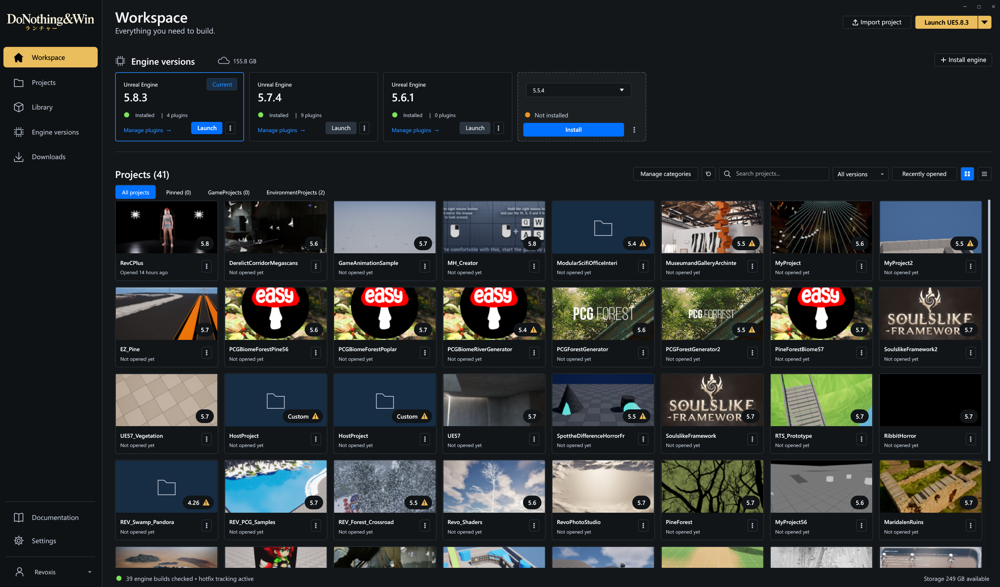
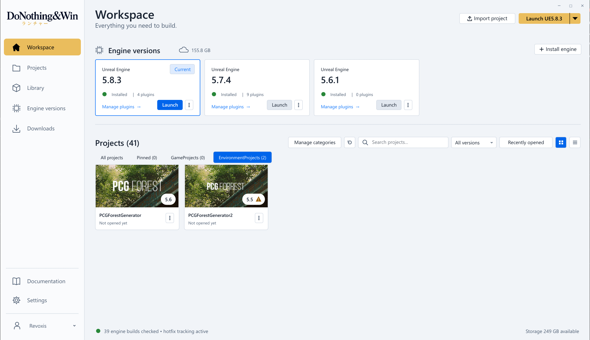
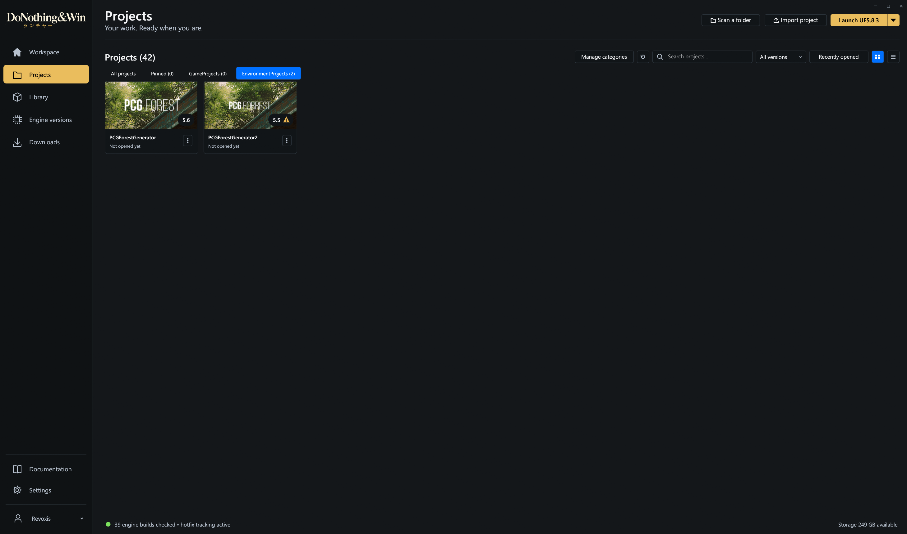
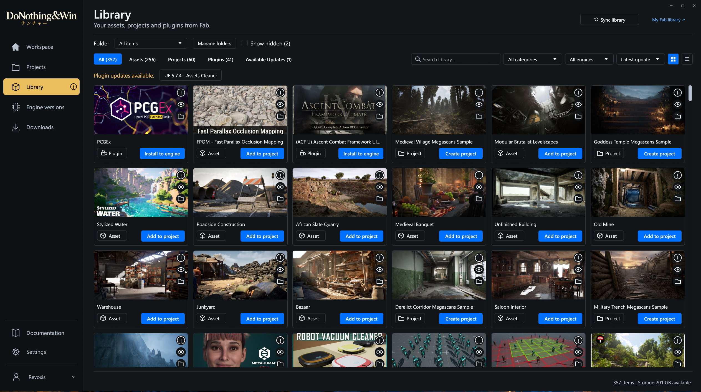
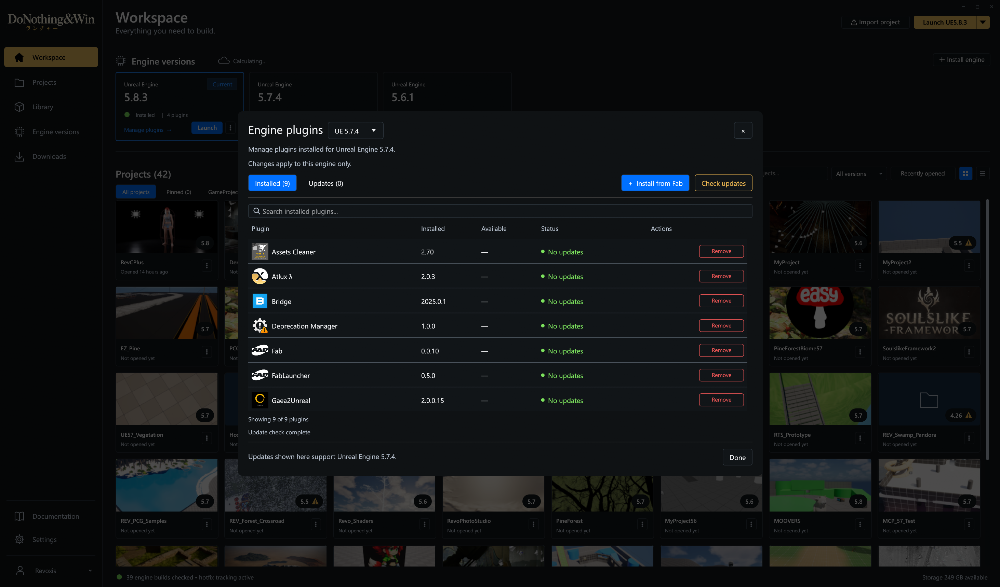
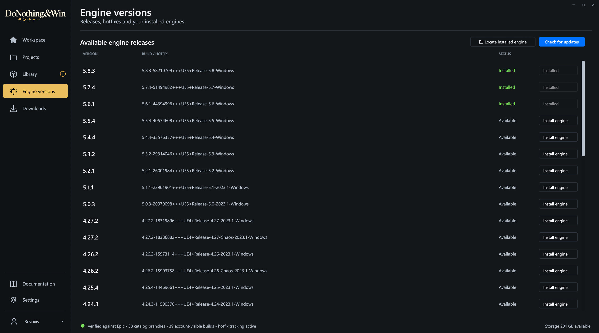
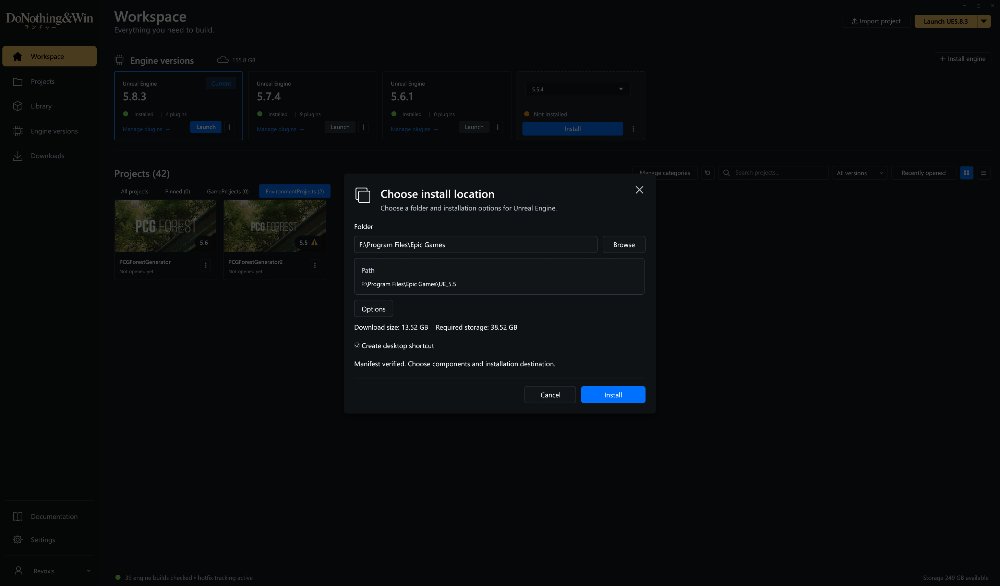
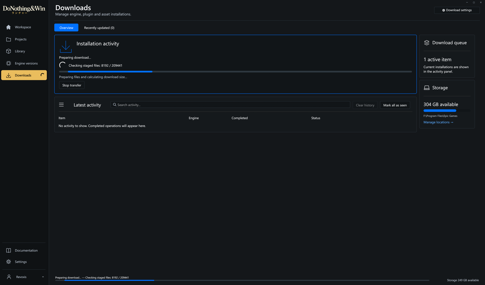
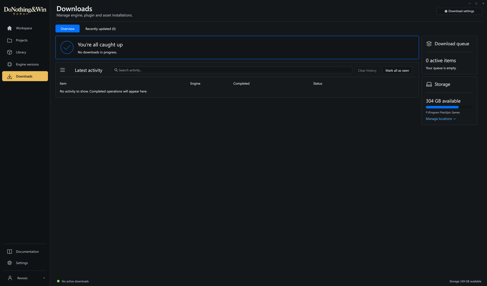
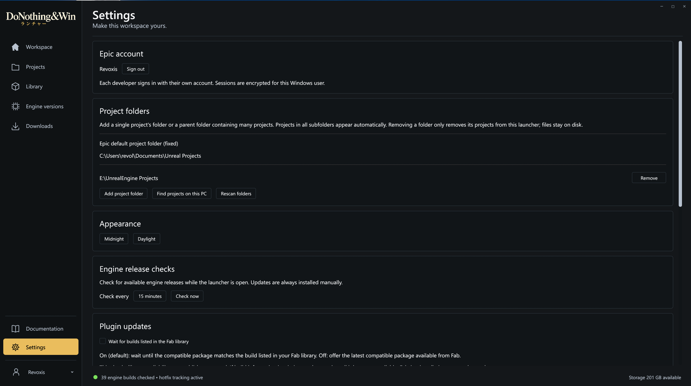

<p align="center"></p>

# DoNothing&Win Launcher

A Windows launcher for **Unreal Engine developers**. Engines, projects, Fab assets, plugins, and downloads. No game library, game store, friends list, chat, or other social features.

## Why this exists

A fun "fine, I'll vibe-code my own" response to the new vibe coded launcher experience. Written with Codex for Unreal Engine developers: engines, projects, Fab assets, plugins, and downloads. No games or social features. Independent of Epic Games.

This is an early community release, not a claim that AI-generated software is automatically reliable. We all know the true state. Bug reports, testing, and contributions are welcome.

## Screenshots

Click any screenshot to view it at full size.

### Workspace



### Light theme



### Projects and categories



### Fab library



### Engine plugins



### Engine versions



### Engine installation



### Installation progress



### Downloads



### Settings



## Download and install

Download the Windows installer, portable ZIP and SHA-256 checksums from the **[latest release](https://github.com/revolutionart/DoNothingAndWin/releases/latest)**. See the [changelog](CHANGELOG.md) for changes.

Current release: **1.2.7** — [Installer](https://github.com/revolutionart/DoNothingAndWin/releases/download/v1.2.7/DoNothingAndWin-Setup-1.2.7.exe) · [Portable ZIP](https://github.com/revolutionart/DoNothingAndWin/releases/download/v1.2.7/DoNothingAndWin-Portable-1.2.7.zip) · [SHA-256 checksums](https://github.com/revolutionart/DoNothingAndWin/releases/download/v1.2.7/SHA256SUMS.txt)

- Windows 10/11, 64-bit. Embedded Epic sign-in needs the [Microsoft Edge WebView2 Runtime](https://developer.microsoft.com/microsoft-edge/webview2/).
- Setup installs for your Windows user; administrator access is not required for the launcher itself. Writing to protected engine folders may require appropriate folder permissions.
- **Launch after setup** is checked by default.
- **Start with Windows** is optional. When selected, **Start in the system tray** is enabled by default, without a taskbar button. Uncheck it during setup or turn off **Start in system tray** in Settings to show the window at sign-in.
- Minimize keeps both versions in the taskbar. In the installed version, Close (X) hides the launcher in the system tray; right-click the tray icon and choose Exit to quit. In the portable version, Close (X) exits the application and no tray icon is created. Windows startup and tray startup can be configured independently in Settings.
- Setup and uninstall do not delete your Unreal projects or engine installations. Uninstall removes launcher files and its startup entry; local launcher settings are retained.
- Setup refuses to replace a running launcher. Finish your transfers and exit before installing an update. It never force-closes a download.
- The launcher checks for stable app updates at startup and daily while open. An available-update notice opens **Settings → Launcher updates**, where you can also check manually and read release notes. From 1.2.1, installed editions offer **Update launcher**: download and verify the installer, finish active operations, install and restart automatically. Startup and shortcut choices are preserved. Portable editions download the new ZIP for manual replacement. Users on 1.2.0 or earlier need to install 1.2.1 manually once to enable this flow for future releases. Windows may still show security prompts for the installer.

Starting with 1.2.2, update verification runs in the background. If setup fails or is cancelled, the launcher reopens once, explains the outcome and waits for you to retry. If it cannot reopen, recovery instructions include the setup log location. Updates started from 1.2.1 still use its earlier recovery behavior.

This release is unsigned; Windows may display an unknown-publisher/SmartScreen prompt. Download only from this repository's releases and compare the provided SHA-256 checksums if needed.

## What it does

### Projects and Workspace

- Discover projects in configured folders, import an existing `.uproject`, or create a blank project.
- Use **Find projects → Quick search** on Workspace or Projects to locate custom project folders. It checks Unreal/Epic project history first, then local drives up to four folders deep, with a 3,000-folder / roughly eight-second search limit. Results appear during the search. Use **Full scan** for deeper locations or **Choose a folder** for a specific location, including network drives. Review suggestions before saving them under **Settings → Project folders**. Both scans can be stopped and skip asset/source folders inside recognized projects.
- Double-click a project to open it with its associated engine. Missing-engine indicators help identify projects that need another engine installed.
- Switch between grid and list views, search with a clear button, filter by engine version, and sort by name or recently opened.
- Browse **All projects**, **Pinned**, and your own category tabs.
- Last-opened times also use Unreal Editor's local recent-project history when available, including projects opened outside this launcher. Projects without a recorded time show **Last opened unknown**.

Right-click a project, or open its **three-dot menu**, for these actions:

| Option | What it does |
| --- | --- |
| **Categories** | Choose an existing category, add a new category and assign the project, or remove its current assignment. |
| **Hide project** | Keep a project out of the launcher’s project lists without deleting or moving its files. Useful for screenshots or keeping your workspace focused. |
| **Create desktop shortcut** | Create a shortcut to open the project. |
| **Clone project** | Make a separate copy of a project. |
| **Pin project / Unpin** | Add or remove the project from the Pinned tab. |
| **Show in Folder** | Open the project’s folder in Windows Explorer. |

**Manage categories** sits next to Refresh. Empty categories can be removed from the manager or by right-clicking their tab. Categories containing projects, including hidden projects, must be emptied first. Hidden projects stay hidden across restarts. Restore one project or all of them in **Settings → Hidden projects**.

### Engine versions

- Discover installed engines, choose the current engine, and launch Unreal Editor.
- Install engine builds with a choice of destination and components, download/storage estimates, and Epic installation registration.
- Use an engine’s three-dot menu to change components through **Options**, **Set Current**, **Create Shortcut**, **Show in Folder**, **Manage Plugins**, **Verify**, or **Remove**.
- Check for available engine releases while the launcher is open. Installations and updates are started manually.

### Fab library and plugins

- Organize items into local folders with the thumbnail's folder icon or right-click menu. Use **Manage folders** to create, rename or delete folders; installed files are not moved.
- Use the eye icon to hide or restore an item. **Show hidden** displays only hidden items. Folder assignments and visibility are saved separately for each Epic account on this PC.
- Click **Update** on a Library plugin to start its update directly. The button shows **Updating** with a spinner; detailed progress appears on Downloads.
- **Wait for builds listed in the Fab library** is on by default for new settings. Existing saved choices are preserved. It waits for matching Windows build metadata and does not verify publisher approval.
- Browse your owned Fab content under **All**, **Assets**, **Projects**, and **Plugins**, with search and engine-version filtering. Sort by **Latest update** (the default) or by name. Fab listing dates load in the background and are cached; items without a date appear last.
- Search titles, descriptions, tags, and publisher names. Title matches appear first, followed by metadata matches, with the chosen sort order applied within each group. Listing details are cached for responsive searches.
- Add assets to an existing project, create projects from supported library templates, and install plugins into multiple selected engines. Each engine gets its latest eligible compatible package.
- Enable **Show all projects** when choosing an asset destination. Projects too old for every available asset version are greyed out, with a reason on hover.
- Manage plugins separately for each engine: search installed plugins, see installed and available versions, check for updates, update, or remove them.
- Plugin updates are checked automatically after startup/sign-in. Each affected engine card shows an orange **Manage plugins** link with a circled exclamation; the Library badge covers updates across engines.
- During a plugin installation, open **Install to engine** for another plugin and use **Add to queue**. Manage waiting jobs in Downloads. The queue lasts for the current session; Stop transfer stops the active job and its remaining engines, while other queued jobs continue.
- Click a library item's title to open its Fab listing in your default browser. Details sit at the top-right of each thumbnail, and compact cards fit more items per row.

### Downloads and activity

- Follow installation progress, transferred bytes, and the active-download indicator beside Downloads in the sidebar.
- Stop an engine transfer and resume it using the same destination to reuse verified files and cached chunks.
- **Dismiss** clears a stopped installation’s resume entry without deleting retained files. Removing its pending engine card also clears the entry.
- Search installation, removal, and verification history; inspect operation details, mark entries as seen, or clear history.
- Set the default engine installation folder, a shared download-speed limit, and installation-completion notifications.

### Everyday use

- Dark and daylight themes, remembered window size, and cached Workspace checks refreshed in the background.
- Optional Windows startup, with tray startup enabled by default for the installed version. Minimize keeps the app in the taskbar. Close (X) hides the installed version in the tray, where **Exit** quits it; the portable version exits directly.
- A single launcher instance, with build handoff allowed only when idle so active transfers are preserved.
- Consistent scrollbars across pages, with a minimum thumb size for large lists. Hidden and minimized windows skip UI rendering and UI-only scans while download workers and scheduled release checks continue.

This does not include Unreal Engine, paid assets, plugins, or games. You use your own Epic account and entitlements. Engine and asset license terms remain their owners' terms. Older assets may be offered for explicit import into a newer project; compatibility is not guaranteed. Assets requiring a newer engine are blocked from older projects.

## Your files and account

The launcher operates on the engines and projects you choose. Installing or uninstalling **the launcher** does not remove those projects. Explicit in-app engine/plugin removal actions do remove the selected engine/plugin.

Local settings, cached library data, activity, and the encrypted Epic session live under `%LOCALAPPDATA%\EngineWorkspace` (the historical internal folder name). On Windows, saved session credentials use DPAPI.

## Build from source

Install stable Rust with the MSVC toolchain and Visual Studio C++ Build Tools / Windows SDK, then:

```powershell
cargo build --release --locked --bins
cargo test --locked --lib --bins --tests
.\target\release\engine-workspace.exe
```

Live account/CDN tests and the native-window test are ignored by default. One offline streaming test writes and verifies a temporary file slightly over 1 GiB, so allow space on your temporary drive.

For portable window behavior, build with `cargo build --release --locked --bin engine-workspace --features portable`. The packaging script builds separate installed and portable executables automatically.

To build the installer, install [Inno Setup 6](https://jrsoftware.org/isinfo.php), then run:

```powershell
powershell -ExecutionPolicy Bypass -File scripts/package.ps1
```

Python 3 is used to gather dependency license notices. Release artifacts are written to `dist/`. See [CONTRIBUTING.md](CONTRIBUTING.md) for development and release details.

## License and independence

[MIT](LICENSE). Third-party dependencies retain their own licenses; packaged builds include their license notices. Epic Games, Unreal Engine, and Fab names belong to their respective owners. This is an independent community project, not an official Epic Games product.
